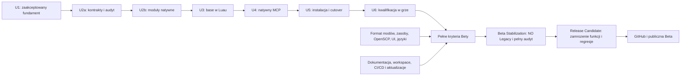

# Roadmapa Simodera

Aktualizacja zakresu Bety, 25 października 2026 r.:
[rozszerzenia API skryptowego](architecture/beta-script-extensions.md) są wymaganym
strumieniem funkcjonalnym. Obejmują PreHook/PostHook, OverrideFunction, GetFunction,
GetReturn, własne zdarzenia, kontrolowane referencje/proxy między modami za zgodą
użytkownika, DelayedCalls z dwoma zegarami, Utils i lokalizację z jawnymi fallbackami.
Dokument zawiera rejestr decyzji H-001–H-014, plan implementacji i kryteria odbioru.
To rozszerzenie celu Bety, bez automatycznej zmiany zakresu trwających U4/U5 ani
stwierdzenia gotowości tych API. Nowy synchroniczny mechanizm między VM wymaga
izolowanego PoC oraz niezależnego audytu przed implementacją produkcyjną.
Pozostałe datowane stany poniżej zachowują swój historyczny zakres.

Stan odniesienia: **15 października 2026 r.**

Celem jest publiczna Beta obejmująca loader, wymagany `base`, OpenSCP/ModStudio,
opcjonalne DevTools oraz udokumentowany proces tworzenia i testowania modów.
Roadmapa porządkuje uzgodnione cele i zależności. Nie jest zgodą na wdrożenie,
publikację, zmianę uprawnień ani rozpoczęcie wszystkich wymienionych prac.

Nie ustalamy dat wydania przed kwalifikacją kluczowych możliwości silnika gry.
Postęp mierzymy zamkniętymi kryteriami, dowodami, audytem i akceptacją człowieka.

## Stan obecny

| Obszar | Stan |
| --- | --- |
| Refaktor i separacja repozytoriów | Wiele podetapów zaakceptowanych; dalsza integracja i weryfikacja pozostają częścią planu. |
| U1 — fundament runtime | Zaimplementowany i zaakceptowany po audycie R21; checkpoint `97e5d66`. |
| U2a — wspólny kontrakt DLL/base/SDK | Bieżący etap; przygotowanie i niezależny audyt zostały zatwierdzone. |
| U3 — base w Luau | Aktualizacja U3: 19 października 2026 r.; pozostałe pierwotne wpisy zachowują stan odniesienia z 15 października 2026 r. Kwalifikacja izolowanego [profilu hosta U3](architecture/u3-host-profile.md): Core41, SDK5, pełne DevTools13, oba kompletne pakiety instalacyjne, osiem kontroli klonów i końcowy etap dowodowy mają niezależnie potwierdzone PASS. Końcowy przegląd całości, checkpointy/rebind i jawna akceptacja całego U3 przez użytkownika pozostają otwarte; nie jest to kwalifikacja gry ani wdrożenie produkcyjne. |
| Architektura managerów `base` | Uzgodniona; nie oznacza wdrożenia managerów, tasków ani transportu między VM. |
| Natywny MCP jako mod DevTool | Architektura przyjęta; migracja istniejącej implementacji pozostaje do wykonania. |
| OpenSCP PR #7 | Zaparkowany w oczekiwaniu na decyzję właściciela upstreamu. |
| Publiczna Beta | Cel; nie jest obecnie gotowa do wydania. |

U1 daje wewnętrzne mechanizmy własności, generacji, uprawnień, zatrzymania i dispatchu.
Nie stanowi publicznego SDK, gotowego `base`, produkcyjnego dostawcy uwierzytelniania
ani potwierdzenia pełnej migracji MCP i działania w rzeczywistej grze.

## Granice odpowiedzialności

| Komponent | Docelowa odpowiedzialność |
| --- | --- |
| Simoder | Jeden zintegrowany x86 `d3d9.dll`: zweryfikowane operacje niskopoziomowe, egzekwowanie tożsamości, uprawnień, wątków i czasu życia. |
| Simoder-Base | W całości autorski Luau: semantyczne API, singletony managerów, fasady przypisane modom, taski, zdarzenia, UI i współpraca modów. |
| Simoder-SDK | Kanoniczne deklaracje i dokumentacja publicznych kontraktów oraz testy zgodności z implementacją. |
| DevTools | Opcjonalne mody developerskie. MCP jest właścicielem protokołu, transportu i katalogu narzędzi; REA pozostaje osobnym narzędziem hosta. |
| OpenSCP / ModStudio | Konwersja `.package`, inspekcja zasobów i edycja projektów modów, zgodnie z zasadami upstreamu. |
| Workspace / Authoring | Składanie środowiska, zewnętrzne kompilatory, build i integracje IDE; narzędzia workstation nie stają się zależnościami instalacji gry. |

Natywne DLL modów są osobną kategorią zaufania i nie mają izolacji sandboxa skryptów.
Opcjonalny mod DLL nie zmienia zasady pojedynczej biblioteki stanowiącej sam loader.

## Główna ścieżka wdrożenia

Etapy U2–U6 opisują migrację fundamentów i MCP. Same nie wyczerpują zakresu Bety:
strumienie funkcjonalne opisane dalej również muszą spełnić kryteria odbioru.
Prace równoległe wymagają osobno zatwierdzonego zakresu i właścicieli plików.

### U2a — wspólny kontrakt DLL/base/SDK

- Zweryfikować obecne VM, scheduler, lifecycle i miejsca bezpiecznego wykonywania operacji.
- Rozstrzygnąć umiejscowienie autorytatywnego `base` i transport między izolowanymi VM.
- Zdefiniować fasady związane z modem, snapshoty, taski, callbacki, `await` i ich sprzątanie.
- Uzgodnić tożsamość wywołującego, generacje, odwoływanie uprawnień i wygasanie kontekstu regionu/miasta.
- Zdefiniować graf zależności oraz zachowanie modułów krytycznych i opcjonalnych.
- Dopasować minimalny ABI do tych wymagań bez kopiowania Core do modów.

**Warunek ukończenia:** spójny kontrakt, mapa istniejących możliwości i luk,
przypadki zgodności/negatywne, niezależny audyt oraz jawna akceptacja przed implementacją.

### U2b — kontrakt i obsługa natywnych modułów

- Wdrożyć zatwierdzony ABI, rejestrację właściciela, prepare/admit/stop/drain i obsługę błędów.
- Egzekwować zaufanie do DLL, architekturę x86, wersje, integralność i bezpieczne wyszukiwanie zależności.
- Zweryfikować podmianę ścieżek/zależności, niezgodne eksporty, reload i retencję wykonywanego kodu.
- Użyć syntetycznych DLL testowych; nie dodawać jeszcze serwera MCP ani nowych operacji gry.

**Warunek ukończenia:** testy pozytywne i negatywne, zachowane regresje U1,
audyt oraz akceptacja. Brak gotowego `base` lub dostawcy autoryzacji nie może być
obchodzony produkcyjnym przełącznikiem testowym.

### U3 — implementacja `base` w Luau

- Utworzyć właściwy pakiet/repozytorium i autorski rejestr singletonów managerów.
- Zapewnić lokalne fasady modów bez współdzielonych mutowalnych globali i wskaźników między VM.
- Wdrożyć taski, zdarzenia, snapshoty, przekazywanie kontekstu i właściwe planowanie callbacków.
- Zapewnić automatyczne sprzątanie generacji, nieważność starych uchwytów i kontrolowany startup/rollback.
- Powiązać deklaracje SDK, dokumentację i przykłady z faktycznym zachowaniem.

**Warunek ukończenia:** dowody zgodności API i izolacji, testy reloadu oraz błędów
zależności, audyt i akceptacja. Pokrycie poszczególnych domen gry rośnie w osobnych
podetapach; istnienie rejestru nie oznacza kompletnego API gry.

### U4 — migracja istniejącego MCP do moda DevTool

- Przenieść odpowiedzialność za MCP do opcjonalnego natywnego moda, korzystającego z `base` i właściwych prymitywów DLL.
- Zachować i zweryfikować dotychczasowe narzędzia, ich schematy, wyniki i ograniczenia.
- Zapewnić singleton, lifecycle związany z grą oraz brak callable MCP przy wyłączonej grze.
- Zakwalifikować uwierzytelnianie, zgodę agentową, odwoływanie dostępu i interoperacyjność klienta.
- Udostępnić konfigurację adresu/portu; nasłuch poza loopbackiem wymaga jawnego opt-in, TLS i osobnych dowodów bezpieczeństwa.
- Uzgodnić rozszerzalność katalogu narzędzi przez mody z egzekwowaniem ich tożsamości i uprawnień.

**Warunek ukończenia:** udokumentowana macierz zgodności istniejących narzędzi,
kwalifikacja transportu i klienta, pomiary zależności/rozmiaru oraz audyt. Test
schematu nie zastępuje potwierdzenia wyniku operacji w grze. Interfejs rozszerzeń
wymaga własnego kontraktu; nie może ominąć autoryzacji.

### U5 — pakietowanie, instalacja i przełączenie na nową architekturę

- Oddzielić instalowalne mody od narzędzi hosta i opcjonalnego authoringu.
- Zachować obsługę zewnętrznych kompilatorów bez pakowania ich do loadera, MCP lub OpenSCP.
- Zapewnić bootstrap wymaganego `base`: brak zależności wymusza widoczną konsolę i proces instalacji za zgodą użytkownika.
- Przełączyć konfigurację klientów i pakiety dopiero po potwierdzeniu zgodności.
- Usunąć zastąpione ścieżki wykonywalnych usług MCP/DevBridge i offline bootstrapu; nie utrzymywać ukrytego fallbacku.

**Warunek ukończenia:** instalacja, odinstalowanie, aktualizacja i odtwarzanie
działają na kontrolowanym środowisku; authoring nie traci funkcjonalności;
stary i nowy serwer nie działają równolegle. Aktywna konfiguracja wymaga właściwej zgody.

### U6 — kwalifikacja rzeczywistej gry i autonomii MCP

- Potwierdzić menu/miasto, pracę w tle, reload, zamknięcie, restart i awarię gry.
- Przeprowadzić testy narzędzi na wybranym sandboxie SinglePlayer, zachowując wyniki i kopie zapisów.
- Egzekwować rozpoznawanie SP/MP; nie zakładać możliwości przywracania regionu Multiplayer.
- Zweryfikować rzeczywistą procedurę backupu, przywrócenia i ponownego wczytania regionu.
- Wykonać instalację od czystej gry i dokumentacji, łącznie z podłączeniem klienta MCP.

**Warunek ukończenia:** powtarzalne dowody działania z dokładnie wskazanymi wersjami
gry i komponentów. Usunięcie sandboxa oraz pełny dump wymagają osobnych zgód.
EA App dopuszcza jedną instancję gry — CI i agent muszą rezerwować ten sam zasób.

## Równoległe strumienie wymagane do Bety

| Strumień | Zakres i kryterium ukończenia | Główne zależności |
| --- | --- | --- |
| Format modów i zasoby | Czytelny format, referencje do vanilla i osobne zmiany; standardowe assety `.png`/`.glb`; zweryfikowane dodawanie nowych zasobów, nie tylko override wartości. | Discovery silnika, DLL, SDK, OpenSCP. |
| Konwersja `.package` | Diff wielu modów względem właściwej vanilla, wybór konfliktów i edycja pól przed eksportem; eksport do `SimCity/mods` i pytanie o włączenie; projekt autorski poza publikowaną zawartością. | Format, referencje, OpenSCP zgodny z upstreamem. |
| Pełność konwersji | Reprezentatywne mody: override, nowe zachowanie, nowe assety i konflikty. Każdy format/typ dopuszczony do eksportu musi mieć działające wsparcie loadera. | Inwentaryzacja kategorii i testy w grze. |
| ModStudio i reloading | Domyślnie `SimCity/mods`, także inne lokalizacje; edycja przy działającej grze; ręczny reload i HotReload/FileWatcher; override bez przeładowania regionu, gdy technicznie bezpieczny; odświeżanie UI gry po zmianie moda, obejmujące refetch danych oraz automatyczne odświeżenie warstwy wizualnej po zapisie pliku, w tym dodawanie i referencjonowanie obrazów. | Loader, API zasobów, wspólna kolejka i wersjonowanie stanu, kontrakt UI oraz bezpieczna rekonstrukcja/invalidacja widoków i zasobów wizualnych. |
| Konflikty i profile | Szybka kolejność ładowania oraz selektywny wybór zmian; wspólna konfiguracja gry i ModStudio; profile domyślne i zestawy przypisane regionom. | `base`, format, synchronizacja i jawne rozstrzyganie konfliktów. |
| Zgodność zapisów | Dokładne wersje i identyfikatory zawartości w snapshotach regionów; blokada brakujących zależności; zatwierdzona migracja na kopii, backup i zweryfikowany rollback. | Katalog zawartości, profile, kwalifikacja przywracania. |
| Luau, JavaScript i TypeScript | Pełne udokumentowane API; wybór/kwalifikacja silnika JS po discovery; TS → JS przez osobno instalowane Node.js + TypeScript, esbuild opcjonalny. | SDK, `base`, izolacja i pomiary rozmiaru DLL. |
| UI i konfiguracja modów | Kompozycyjne API UI; sekcja modów w trzech menu gry i ustawienia regionów; konfiguracja modów przez API; zastąpienie i usunięcie overlayu z produkcyjnej Bety. | Zweryfikowane prymitywy UI, `base`, testy interakcji przez MCP. |
| Współpraca modów | Jawne wykrywanie zależności i rejestracja integracji, np. BusLine w RoadBuilderze; brak podszywania się przez przekazywanie cudzej fasady. | Tożsamość, managerowie i kontrakt współpracy w `base`. |
| Bezpieczeństwo i diagnostyka | Uprawnienia wymagane/opcjonalne, tryb ograniczony, osobne zaufanie do DLL, generacyjna izolacja błędów DEV/REGULAR; ograniczona diagnostyka domyślna, pełny dump wyłącznie za osobną zgodą. | DLL, `base`, MCP, testy odmów i odwołania dostępu. |
| Aktualizacje | Wersjonowanie Simodera/modów, abstrakcyjny aktualizator i adapter GitHub na Betę; systemowy magazyn poświadczeń; podpisany wydawca niezależny od zaufania do źródła. | Manifesty, zaufanie, procedura aktualizacji/rollbacku i walidacja regionu. |
| Workspace, przykłady i dokumentacja | Osobny CLI składający środowisko z artefaktów lub źródeł dev, proste szablony przez clone, działające DevTools i authoring; indeksowane API/skills i zgodność deklaracji z kodem. | Wydzielone repozytoria, przypięte wersje i kanoniczny SDK. |

Nie eksportujemy niezmienionych assetów EA. Zasoby vanilla są referencjami.
Konwersja, której nie da się wykonać zgodnie z tym ograniczeniem, kończy się jasną
odmową; samo takie wykluczenie nie blokuje Bety. Nie jest to zwolnienie z budowy
mechanizmu referencji ani z obsługi technicznie wspieranych kategorii modów.

Pełne API UI, dowolne drogi/proceduralne assety, sandbox JS i odtwarzanie regionu
wymagają dowodów z silnika. Nie są gotowe tylko dlatego, że znalazły się w roadmapie.

## Demonstrator odbiorowy: RoadBuilder + BusLine

To test integracyjny całego ekosystemu, nie osobny pokaz UI:

1. Agent tworzy RoadBuildera w Luau i integrację BusLine w TS/JS przez publiczne API.
2. Mod generuje niestandardową drogę: pasy, kierunki, szerokości, prędkości i elementy otoczenia.
3. Wykorzystuje nowe modele/tekstury oraz współdziałające rozszerzenia UI.
4. MCP potwierdza interakcje, budowę, zapis presetów i rzeczywiste użycie drogi przez symulację.
5. Zapis i ponowne wczytanie zachowują wymagane zasoby, wersje i konfigurację.
6. Zmiany oraz wyłączenie/reload mają udokumentowane skutki i bezpieczne ograniczenia.

### Kryterium HotReload UI

HotReload obejmuje nie tylko kod i dane moda, ale także obserwowalne UI gry. Po
zaakceptowaniu zmiany i zapisaniu pliku wymagane są:

- ponowne pobranie aktualnych danych używanych przez widok (refetch), bez
  pozostawienia starego snapshotu jako pozornie aktualnego;
- odświeżenie struktury i stanu widoku bez restartu gry, a gdy wymaga tego
  zweryfikowany kontrakt silnika — bez przeładowania regionu;
- przeładowanie zmienionych stylów, layoutów, materiałów i innych elementów
  wizualnych w modelu zbliżonym do Vite + React: zapis pliku uruchamia zmianę
  widoczną w działającym UI;
- dodanie nowego obrazu/tekstury, jego poprawne załadowanie oraz użycie przez
  referencję w UI lub zasobie moda;
- jawny wynik odświeżenia i bezpieczny fallback: błąd, nieobsługiwany typ lub
  nieaktualna referencja nie może pozostawić częściowo zastosowanego widoku ani
  uszkodzić aktywnej generacji.

Zakres nie oznacza bezwarunkowego odświeżania dowolnego stanu skopiowanego przez
grę. Każda taka granica musi być wykrywalna, udokumentowana i zweryfikowana;
jeżeli bezpieczne odświeżenie wymaga rekonstrukcji konkretnego panelu lub obiektu,
HotReload musi wykonać tę rekonstrukcję albo jawnie zgłosić ograniczenie.

Agent pracuje autonomicznie przez MCP po otrzymaniu właściwej zgody. Zbędna
interwencja gracza jest blokerem przebiegu. Computer Use może niezależnie potwierdzać
wynik, lecz nie zastępuje brakujących narzędzi MCP. Audyt człowieka ocenia również
jakość moda i problemy runtime przeoczone przez agenta.

## Infrastruktura i publiczne wydanie

Do zamknięcia zakresu Bety używamy prywatnego Gitea/Karpiera i runnera działającego
na tym samym komputerze co gra. Publikowane artefakty kanału głównego oraz możliwość
zbudowania wersji dev ze źródeł mają tworzyć powtarzalny workspace. Po przygotowaniu
środowiska zwykła praca musi być możliwa offline; instalacja i aktualizacje mogą wymagać sieci.

Przed publiczną Betą:

- zakończyć i zaakceptować refaktor oraz regresje repozytoriów;
- zamknąć wszystkie obowiązkowe funkcjonalności i blokery Bety;
- przygotować podpisane manifesty, zaufanie wydawcy i bezpieczne aktualizacje;
- zweryfikować limity CI/artifactów/Releases i rozmiar dystrybucji, bez Git LFS;
- odtworzyć czysty workspace i instalację według dokumentacji;
- przenieść stabilny przepływ na GitHub/GitHub Actions i sprawdzić go tam;
- zapewnić automatyczny review PR, przy zachowaniu lokalnego audytu i jawnej akceptacji L2/L3;
- opublikować wersjonowane API, formaty, przykłady, instrukcje natywnych modów i wymagania środowiska.

Windows jest platformą docelową gry/runtime; obsługiwane konfiguracje wymagają
rzeczywistych testów. Proton/Linux pozostają osobną kwalifikacją eksperymentalną.
Prywatny SimCity Launch Fix nie wchodzi do publicznej dystrybucji.

**Publiczna Beta rozpoczyna zobowiązanie do kompatybilności API i formatów.**
Prototyp/alpha nie wymagają utrzymywania migracji przestarzałych formatów, ale
nie zwalnia to z bieżącej walidacji, bezpieczeństwa ani ochrony zapisów.

## Beta Stabilization / Legacy Elimination i Release Candidate

Uzgodnienie z 17 października 2026 r.: cleanup trwa w każdym etapie migracji;
zastąpiony kod usuwamy w etapie przejmującym jego odpowiedzialność. Tymczasowe
pozostałości wymagają wskazania właściciela, powodu i etapu usunięcia w `.analysis/`.

Po potwierdzeniu zakresu **i implementacji wymaganych funkcjonalności Bety**, przed
utworzeniem Release Candidate, wykonujemy zbiorczy cleanup i niezależny pełny audyt:
DRY/SOLID, granice repozytoriów, martwy kod, bezpieczeństwo, lifecycle, zależności,
konfiguracje, dokumentacja i faktyczna zawartość dystrybucji.

**Strictly NO Legacy jest warunkiem wejścia do RC.** Samo wyłączenie starej ścieżki
flagą lub usunięcie jej z paczki nie wystarcza. U3 nie zamyka tej bramki za U4/U5
ani za zastąpienie overlayu. Szczegółowy zakres i zasady klasyfikacji określa
[kontrakt release hygiene](architecture/release-hygiene.md).

Po audycie i akceptacji zamrażamy funkcje RC i wykonujemy pełną regresję, czystą
instalację oraz demonstrator autonomii na dokładnym kandydacie. Istotne poprawki
wymagają odpowiednich testów, ponownego niezależnego audytu i aktualizacji dowodów.
Publikacja nadal wymaga osobnej autoryzacji; zaparkowane prace nie są odblokowane.

## Bramka ukończenia Bety

- [ ] U2a–U6 mają wymagane dowody, audyty i akceptacje; nie pozostał niejawny fallback starej architektury MCP.
- [ ] Przed RC zamknięto Beta Stabilization / Legacy Elimination: Strictly NO Legacy i niezależny pełny audyt dokładnego zestawu źródeł, zależności oraz dystrybucji, z wymaganą akceptacją człowieka.
- [ ] Dokładny Release Candidate po zamrożeniu funkcji przeszedł regresje; istotne poprawki mają aktualne testy i niezależny audyt.
- [ ] Wymagany `base`, skrypty Luau/JS/TS i natywne DLL mają działające, zgodne z SDK kontrakty.
- [ ] OpenSCP/ModStudio, konwersja, nowe zasoby, UI, HotReload, konflikty i profile spełniają opisane kryteria.
- [ ] Wersjonowanie regionów, zależności, backup i właściwe procedury migracji/rollbacku są zweryfikowane.
- [ ] RoadBuilder + BusLine przechodzi test autonomii, symulacji i zapisu/odczytu.
- [ ] Czysta instalacja, workspace, dokumentacja, diagnostyka, zgody i aktualizacje przechodzą kwalifikację.
- [ ] GitHub/Actions i publiczne artefakty mają potwierdzoną integralność oraz właściwy zakres dystrybucji.
- [ ] Właściciel projektu jawnie akceptuje wydanie; publikacja ma osobną autoryzację.

## Utrzymanie roadmapy

Po każdym zaakceptowanym etapie aktualizujemy status i odnośnik do dowodów.
Nie odhaczamy projektu na podstawie samego buildu, deklaracji API lub syntetycznego
testu. Zmiany zakresu i terminu pozostają jawnymi decyzjami; audyty i surowe dowody
trzymamy w `.analysis/`, a utrzymywany plan w tym dokumencie.

Dokumenty źródłowe: [granice repozytoriów](architecture/repository-ownership.md),
[architektura base](architecture/base.md), [migracja MCP](architecture/mcp-devtool.md),
[fundament U1](architecture/runtime-foundation.md),
[kompatybilność](architecture/compatibility.md).

## Crash Handler i rozszerzona diagnostyka Bety

Dodatkowy wymagany zakres Bety: okno awarii z raportem, call stackiem, redakcją danych wrażliwych oraz przyciskami kopiowania raportu i otwierania katalogów raportów/logów. Rozszerzyć logowanie o zweryfikowane kanały silnika (w tym stderr, jeśli używany) i bridge frontend/silnik.

[Zakres, decyzje i plan diagnostyki](architecture/crash-diagnostics.md). Osobne discovery porówna wariant bez dodatkowego EXE i proces pomocniczy; wyjątek od dystrybucji DLL nie jest jeszcze zatwierdzony. Zaplanować osobny audytowany etap przed kwalifikacją U6, a wymagania diagnostyczne uwzględnić już w planowaniu U3. Bramka Bety obejmuje testy okna awarii, stosów, redakcji danych oraz kanałów logowania.
